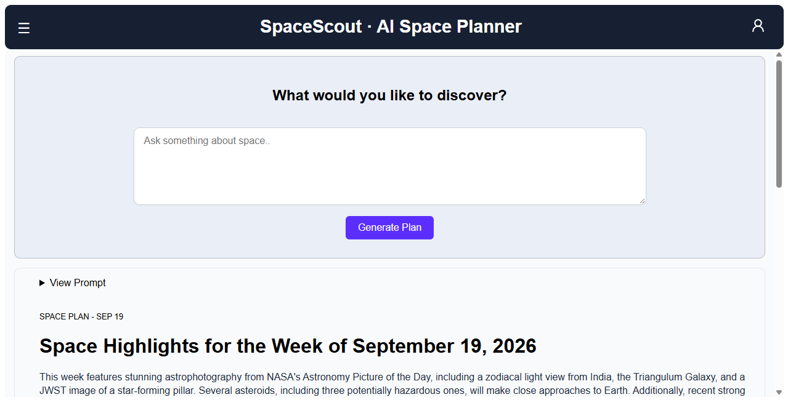
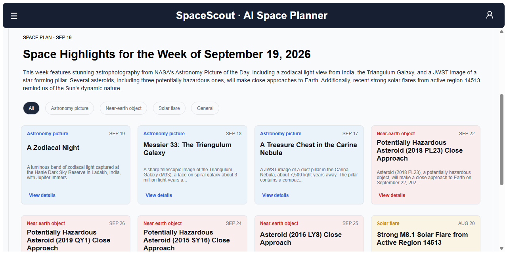
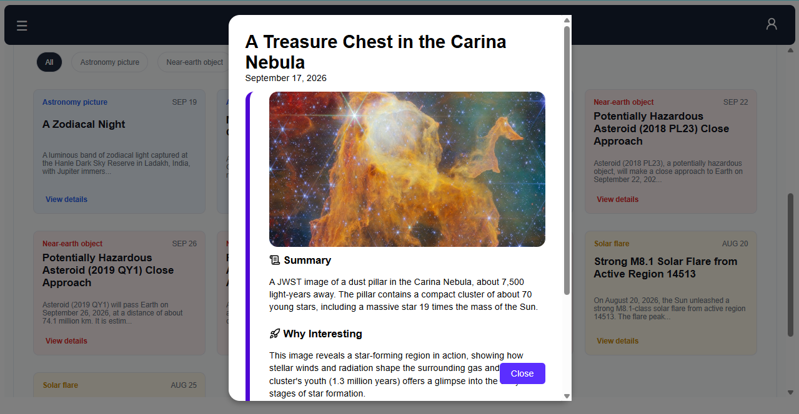

# SpaceScout - AI Space Planner

SpaceScout is a web application that lets users explore space-related information through natural-language requests.

Instead of requiring users to know which NASA API to use or how to structure a query, SpaceScout uses an AI model to interpret the user's request, determine what information is needed, retrieve relevant NASA data, and organize the results into a structured Space Plan.

Users can:

* Ask natural-language questions about space
* Discover NASA information and media
* View structured discovery cards
* Save generated Space Plans
* Revisit previous plans
* View the original prompt used for a plan
* Delete saved plans
* Manage their account through authentication

The application consists of a React and TypeScript frontend and a Django REST Framework backend. The backend uses SQLite for database persistence and JWT authentication for protected API access.

---

# Distinctiveness and Complexity

SpaceScout is an AI-assisted scientific-data exploration application. Its primary purpose is to act as an interface between a user's natural-language question and structured information provided by NASA's APIs.

The distinctive part of the application is not simply that it uses an AI model. The AI is integrated into the application's data retrieval workflow. It can decide which available NASA tools are relevant to a request, call those tools with appropriate parameters, examine their results, and then organize the returned information into a structured Space Plan that the rest of the application can process.

For example, a user can ask a question such as:

```text
What interesting things are happening in space this week?
```

The application does not send this question directly to an AI model and display a generated paragraph. Instead, the request passes through a multi-stage pipeline:

1. The React frontend sends the user's request to the Django backend.
2. Django validates the request and passes it to the Space Planner engine.
3. The AI planner receives the user's request together with instructions describing the available NASA tools and the required output format.
4. The AI determines which NASA services are relevant to the request.
5. The planner executes the selected tools, which can retrieve data from NASA's Astronomy Picture of the Day, Near Earth Object Web Service, or DONKI solar-flare service.
6. The returned API data is provided back to the AI planner for analysis.
7. The planner combines the relevant results into a structured Space Plan.
8. Pydantic validates the AI-generated structure against the application's schema.
9. The validated Space Plan and its discoveries are saved to the Django database.
10. Django returns the structured result to React.
11. React renders the Space Plan as discovery cards that the user can inspect and expand.

Creating a separation between the AI reasoning layer, external data layer, application logic, database layer, and user interface.

### AI Planning and Tool Use

The AI engine is implemented separately from the Django views. The `space_planner.py` module handles the interaction with OpenRouter through the OpenAI-compatible API.

The application defines a registry of available NASA tools. Each tool contains a handler, description, and parameter definitions. These definitions are converted into function tools that can be provided to the AI model.

The planner supports multiple tool calls during an investigation. A maximum number of tool rounds is enforced so that a request cannot cause an unlimited sequence of external calls. The number of discoveries is also limited before the result is returned to the frontend.

The AI output is not trusted as arbitrary text. The application uses a Pydantic schema to describe the expected structure of a Space Plan and validates the model's final response against that schema. If the model produces invalid JSON or a response that does not satisfy the schema, the planner attempts to request a corrected response before reporting an error.

The project also implements a model fallback mechanism. If the configured OpenRouter model fails, the planner can fall back to `openrouter/free`. This allows the application to continue working when the preferred model is unavailable.

### NASA API Integration

SpaceScout currently integrates three NASA data services:

* NASA Astronomy Picture of the Day (APOD)
* NASA Near Earth Object Web Service (NeoWs)
* NASA DONKI Solar Flare API

Each service has its own function in the NASA service layer. The AI does not directly construct arbitrary HTTP requests. Instead, it selects from the tools registered by the application, and the backend executes the corresponding functions.

The NASA service layer also handles HTTP errors, including rate-limit responses, authentication errors, and network failures. This keeps external API communication separate from the AI planning and database logic.

### Structured Data and Persistence

The application uses Django models to represent users, Space Plans, and individual discoveries.

A Space Plan belongs to the authenticated user and can contain multiple discoveries. Each discovery stores information such as its type, title, date, summary, facts, source URL, and optional media.

The application therefore does more than display a temporary API response. Generated Space Plans are persisted in the database and can be retrieved later through the history sidebar.

The backend also restricts Space Plan queries to the currently authenticated user. This means a user retrieves and deletes only their own saved plans.

### Frontend and Backend Separation

The project has a separate React frontend and Django REST backend.

The React application handles the user interface, routing, authentication state, loading states, discovery cards, modals, and history navigation. Axios is used to communicate with the backend.

The Django backend provides the API, authentication endpoints, database models, serializers, AI planning engine, and NASA integration.

This separation requires the two sides of the application to communicate through defined API structures. TypeScript interfaces in the frontend describe the Space Plan and Discovery objects returned by the backend.

For these reasons, SpaceScout involves substantially more than a single CRUD workflow. It combines natural-language processing through an external AI model, function/tool calling, multiple external APIs, structured-output validation, authentication, database relationships, API serialization, error handling, and a separate typed frontend.

---
## Why I Built This

I built SpaceScout because I have always been interested in astronomy, but I found that exploring NASA's APIs directly can be overwhelming. NASA provides different APIs for different types of space information, and a user often needs to know which API is appropriate, what parameters it expects, and how to interpret the returned data.

I wanted to build an application that would make this process more approachable. Instead of requiring users to understand the structure of NASA's APIs, they can simply describe what they are interested in using natural language. SpaceScout then uses an AI planning layer to determine what information is relevant, retrieves data from NASA, and presents the results as organized discoveries.

The project therefore combines two of my interests: software development and astronomy. Rather than building a general-purpose chatbot, I wanted the AI to have a specific job inside an application: investigating space-related questions using real external data and turning that information into a structured experience.

---

# Project Screenshots

**Home Page**



**Discoveries**



**Discovery Expanded Example**



---

# Features

## Authentication

* User registration
* User login
* JWT authentication
* Access-token refresh
* Protected routes
* User-specific Space Plan history
* Automatic access-token refresh when an authenticated request receives a 401 response

## AI Planning

* Natural-language prompts
* AI-assisted planning
* Tool/function calling
* Structured planner output
* Pydantic validation
* Model fallback
* General and space-related question handling
* Multiple tool-call rounds for complex requests

## NASA Integration

The application can retrieve information from multiple NASA services:

* NASA Astronomy Picture of the Day (APOD)
* NASA Near Earth Object Web Service (NeoWs)
* NASA DONKI solar flare data
* NASA media associated with discoveries

## Space Plans

* Generate a structured Space Plan
* Save plans to the database
* View previous plans
* View the original prompt
* Delete plans
* Interactive discovery cards
* Expand discovery details
* Filter discoveries by category

## User Interface

* React and TypeScript
* Responsive layout
* Mobile-friendly navigation
* Toggleable history sidebar
* Loading states
* Error states
* AI processing/status feedback
* Responsive discovery cards
* Discovery detail modal
* 404 page

---

# Technologies Used

## Backend

* Python
* Django
* Django REST Framework
* Django ORM
* SQLite
* Django Simple JWT
* Pydantic
* OpenAI Python SDK
* HTTPX
* python-dotenv

## Frontend

* React
* TypeScript
* Vite
* Axios
* React Router
* Lucide React
* CSS

## External Services

* OpenRouter
* NASA APIs

---

# File Structure and Code Description

The following describes the files to which I contributed code and their responsibilities within the application.

## Backend

### `backend/manage.py`

Django's command-line entry point. It is used to run the development server, apply database migrations, and execute other Django management commands.

### `backend/config/settings.py`

Contains the main Django configuration, including installed applications, middleware, database configuration, REST framework settings, authentication configuration, CORS configuration, and environment-related settings.

The project uses SQLite as its development database.

### `backend/config/urls.py`

Defines the root URL configuration for the Django project. It connects the Django administration interface and the application's API URL configuration.

### `backend/config/asgi.py`

Provides the ASGI application entry point for Django.

### `backend/config/wsgi.py`

Provides the WSGI application entry point for Django.

### `backend/config/__init__.py`

Marks the `config` directory as a Python package.

---

## Backend API Application

### `backend/api/models.py`

Defines the application's database models.

`User` extends Django's `AbstractUser`. `SpacePlan` represents a saved investigation belonging to a user, while `Discoveries` represents the individual NASA-related findings associated with a Space Plan.

A Space Plan stores its original prompt, title, summary, and timestamps. A discovery stores its category, title, date, summary, explanation of why it is interesting, structured facts, source URL, and optional media.

### `backend/api/serializers.py`

Defines Django REST Framework serializers.

`UserSerializer` handles registration and validates usernames and passwords. `DiscoveriesSerializer` serializes individual discoveries, while `SpacePlanSerializer` serializes a complete Space Plan and its discoveries. `SpacePlanRequestSerializer` validates incoming user prompts.

### `backend/api/views.py`

Contains the API views used by the frontend.

The views handle user registration, retrieving authenticated users' Space Plans, retrieving or deleting individual plans, and creating new Space Plans by passing the user's prompt to the Space Planner engine.

The Space Plan list and detail views filter their querysets using the authenticated user so users cannot access another user's plans.

### `backend/api/urls.py`

Defines the application's API routes, including registration, JWT token creation and refresh, Space Plan creation, Space Plan listing, and Space Plan retrieval/deletion.

### `backend/api/admin.py`

Provides the Django admin configuration for the application.

### `backend/api/apps.py`

Contains the Django application configuration for the `api` application.

### `backend/api/__init__.py`

Marks the API directory as a Python package.

### `backend/api/tests.py`

Contains the Django test module for the API application.

---

# AI Planning Engine

### `backend/api/engine/space_planner.py`

Contains the main Space Planner execution logic.

This module connects to OpenRouter using the OpenAI-compatible Python SDK, sends the user's request to the AI model, handles tool calls, passes NASA results back to the model, and requests the final structured Space Plan.

It also performs JSON/Pydantic validation, limits tool-call rounds and discovery count, and retries when the final model response does not satisfy the required schema.

### `backend/api/engine/schema.py`

Defines the Pydantic data models used to validate AI-generated results.

The main schemas are `Media`, `Discovery`, and `SpacePlan`.

### `backend/api/engine/system_prompt.py`

Contains the system instructions used by the Space Planner.

The prompt defines how the AI should investigate requests, when it should use NASA tools, how it should handle empty or failed results, how discoveries should be structured, and the required JSON format.

### `backend/api/engine/tool_registry.py`

Defines the NASA tools available to the AI planner.

Each registered tool contains its handler, description, and parameters. The module also converts the registry into the function-tool format expected by the OpenAI-compatible API.

The current registry contains the APOD, Near Earth Object, and solar-flare tools.

### `backend/api/engine/model_switch.py`

Implements the AI model fallback mechanism.

The module attempts to call models in sequence and switches to the next configured model if the previous model fails. If every configured model fails, it raises `AllModelsFailedError`.

---

# Backend Application Services and Helpers

### `backend/api/app_services/space_plan.py`

Contains the database persistence logic for generated Space Plans.

The `save_space_plan` function creates the Space Plan and its associated discoveries inside a database transaction. It also converts the validated discovery dates and optional media information into the corresponding Django model fields.

### `backend/api/helper_functions/date_parser.py`

Contains a helper function for converting formatted discovery dates into Python `date` objects.

---

# NASA Service Layer

### `backend/api/services/nasa/nasa_services.py`

Contains the functions responsible for communicating with NASA's external APIs.

The module defines the NASA APOD, NeoWs, and DONKI endpoints and provides functions for retrieving astronomy pictures, near-Earth objects, and solar flare activity.

It also contains common HTTP error handling for API rate limits, rejected API keys, other HTTP errors, and network failures.

---

# Database Migrations

### `backend/api/migrations/0001_initial.py`

Creates the initial custom `User` database model.

### `backend/api/migrations/0002_spaceplan_discoveries.py`

Creates the `SpacePlan` and `Discoveries` models and their relationship.

### `backend/api/migrations/0003_spaceplan_prompt.py`

Adds the original user prompt field to the `SpacePlan` model.

### `backend/api/migrations/__init__.py`

Marks the migrations directory as a Python package.

---

# Backend Project Configuration

### `backend/requirements.txt`

Lists the Python dependencies required by the backend, including Django, Django REST Framework, Simple JWT, Pydantic, OpenAI, HTTPX, and python-dotenv.

### `backend/pyproject.toml`

Contains Python project/tooling configuration.

### `backend/uv.lock`

Contains the locked Python dependency information generated for the project's environment.

### `backend/.python-version`

Specifies the Python version/environment used by the project.

### `backend/.gitignore`

Lists backend-specific files and directories that should not be committed to version control.

### `backend/src/backend/__init__.py`

Contains the package initialization code for the backend package included in the project structure.

---

# Frontend

### `frontend/src/main.tsx`

The entry point of the React application. It creates the React root, loads the global stylesheet, wraps the application in `AuthProvider`, and renders the main `App` component.

### `frontend/src/App.tsx`

Defines the application's React Router configuration.

It separates public routes such as login and registration from protected routes such as the planner and provides a fallback 404 route.

---

# Frontend API Layer

### `frontend/src/api/axios.ts`

Creates the Axios clients used to communicate with Django.

It automatically attaches the stored JWT access token to authenticated requests and handles expired access tokens by using the refresh token to obtain a new access token before retrying the original request.

### `frontend/src/api/auth.ts`

Contains API functions for user authentication, including login, registration, and access-token refreshing.

### `frontend/src/api/planner.ts`

Contains API functions for creating, retrieving, listing, and deleting Space Plans.

---

# Authentication and Routing

### `frontend/src/context/AuthContext.tsx`

Provides shared authentication state to the React application.

It stores whether the user is authenticated and provides login and logout functions to components that need authentication functionality.

### `frontend/src/components/ProtectedRoutes.tsx`

Protects authenticated routes from unauthenticated users.

It also provides the shared layout for authenticated pages and manages the open/closed state of the history sidebar.

### `frontend/src/components/PublicRoute.tsx`

Handles public routes and redirects already authenticated users to the planner.

---

# Frontend Components

### `frontend/src/components/Navbar.tsx`

Renders the application's navigation bar, account controls, logout functionality, and history-sidebar toggle.

### `frontend/src/components/HistorySidebar.tsx`

Displays the authenticated user's saved Space Plans.

It retrieves the user's history from the backend, sorts plans by creation date, allows the user to select a previous plan, and provides a confirmation interface before deleting a plan.

### `frontend/src/components/PlannerLoading.tsx`

Displays the loading interface while a Space Plan is being generated. It cycles through different status messages while the AI planner and NASA services are processing the request.

---

# Space Plan Components

### `frontend/src/components/spaceplanpage/RenderSpacePlan.tsx`

Renders a complete Space Plan, including its title, summary, prompt, and discovery cards.

It also manages discovery-category filtering and the currently selected discovery.

### `frontend/src/components/spaceplanpage/DiscoveryPreview.tsx`

Renders the compact version of an individual discovery card, including its category, date, title, and summary information.

### `frontend/src/components/spaceplanpage/DiscoveryModal.tsx`

Displays the expanded information for a selected discovery in a modal interface.

### `frontend/src/components/spaceplanpage/PromptPreview.tsx`

Displays the original natural-language prompt used to generate a Space Plan.

---

# Frontend Pages

### `frontend/src/pages/Login.tsx`

Provides the login interface. It collects the username and password, calls the authentication context, handles loading/error states, and redirects authenticated users to the planner.

### `frontend/src/pages/Register.tsx`

Provides the account registration interface. It validates the registration fields and creates a new account through the backend API before allowing the user to log in.

### `frontend/src/pages/Planner.tsx`

Contains the main SpaceScout interface.

It accepts the user's natural-language prompt, sends it to the backend, displays loading and error states, renders the returned Space Plan, and integrates the history sidebar.

### `frontend/src/pages/NotFound.tsx`

Provides the application's 404 page for unknown routes.

---

# Frontend Types and Utility Functions

### `frontend/src/types/auth.ts`

Defines TypeScript interfaces for authentication token responses.

### `frontend/src/types/planner.ts`

Defines TypeScript interfaces for `Discovery`, `SpacePlan`, and Space Plan request data. These types describe the structures exchanged between the frontend and backend.

### `frontend/src/func/assets.ts`

Contains mappings used by the frontend to display human-readable names for discovery categories.

### `frontend/src/func/parsedate.ts`

Contains the date-formatting helper used by discovery cards and other frontend components.

---

# Frontend Styles

### `frontend/src/index.css`

Contains the global CSS applied to the React application.

### `frontend/src/styles/DiscoveryModal.css`

Styles the expanded discovery modal.

### `frontend/src/styles/DiscoveryPreview.css`

Styles individual discovery preview cards.

### `frontend/src/styles/HistorySidebar.css`

Styles the history sidebar, its responsive behavior, overlay, and deletion confirmation interface.

### `frontend/src/styles/LoginRegister.css`

Styles the login and registration pages.

### `frontend/src/styles/Navbar.css`

Styles the navigation bar and its controls.

### `frontend/src/styles/NotFound.css`

Styles the 404 page.

### `frontend/src/styles/Planner.css`

Styles the main planner page and prompt interface.

### `frontend/src/styles/PlannerLoading.css`

Styles the loading animation and status messages displayed while a Space Plan is being generated.

### `frontend/src/styles/PromptPreview.css`

Styles the expandable original-prompt section.

### `frontend/src/styles/RenderSpacePlan.css`

Styles the overall Space Plan display and its title, summary, and discovery sections.

---

# Frontend Project Configuration

### `frontend/package.json`

Defines the frontend dependencies and development scripts. The project uses React, TypeScript, Vite, Axios, React Router, Lucide React, and ESLint.

### `frontend/package-lock.json`

Locks the installed npm dependency versions.

### `frontend/vite.config.ts`

Configures Vite and the React plugin used to build and run the frontend.

### `frontend/eslint.config.js`

Contains the ESLint configuration used for frontend code quality checks.

### `frontend/tsconfig.json`

Provides the top-level TypeScript project configuration and references the application and Node-specific TypeScript configurations.

### `frontend/tsconfig.app.json`

Contains TypeScript compiler settings for the React application source code.

### `frontend/tsconfig.node.json`

Contains TypeScript compiler settings used for Node/Vite configuration files.

### `frontend/index.html`

Provides the HTML entry document into which the React application is mounted.

### `frontend/.gitignore`

Lists frontend-specific generated files and directories that should not be committed.

### `frontend/README.md`

Contains the frontend project's development information generated as part of the Vite project setup.

---

# Public and Asset Files

### `frontend/public/nasa-6-logo-svgrepo-com.svg`

Contains the NASA-related SVG asset used by the frontend.

### `frontend/public/spacescout-logo.png`

Contains the SpaceScout logo used by the application.

### `frontend/src/assets/delete-svgrepo-com.svg`

Delete icon used by the history interface.

### `frontend/src/assets/document-text-svgrepo-com (1).svg`

Document-related interface icon.

### `frontend/src/assets/icons8-delete.svg`

Additional delete icon asset.

### `frontend/src/assets/nasa-6-logo-svgrepo-com.svg`

NASA logo asset used within the frontend source.

---

# Complete Setup

## Requirements

* Python 3
* Node.js and npm
* Git
* A NASA API key
* An OpenRouter API key

---

# 1. Clone the Repository

```bash
git clone https://github.com/Tamercan1/spacescout-ai-space-planner.git
cd spacescout-ai-space-planner
```

---

# 2. NASA API Setup

The project uses NASA APIs to retrieve space-related information.

NASA provides an API key through its API portal.

### Get a NASA API Key

1. Go to the NASA API portal:
   https://api.nasa.gov/
2. Enter your name and email address.
3. Request an API key.
4. Copy the generated API key.

NASA also provides a `DEMO_KEY`, but using your own key is recommended for normal development because the demo key has lower usage limits.

Add your key to your backend environment file.

Example:

```env
NASA_API_KEY=your_nasa_api_key
```

---

# 3. OpenRouter Setup

The project uses OpenRouter to access the configured AI model.

### Get an OpenRouter API Key

1. Create an account at:
   https://openrouter.ai/
2. Open your account's API key section.
3. Create a new API key.
4. Copy the key.

Add it to your backend environment file.

Example:

```env
OPENROUTER_API_KEY=your_openrouter_api_key
```

You can optionally configure the AI model:

```env
LLM_MODEL=your_model_name
```

If no model is specified, the application uses `openrouter/free`.

---

# 4. Environment Variables

Create a `.env` file inside the `backend` directory:

```env
NASA_API_KEY=your_nasa_api_key
OPENROUTER_API_KEY=your_openrouter_api_key
LLM_MODEL=your_model_name
```

`LLM_MODEL` is optional. If it is not provided, the planner falls back to `openrouter/free`.

---

# 5. Backend Setup

Open a terminal:

```bash
cd backend
```

Create a virtual environment:

```bash
python -m venv venv
```

### Windows

```bash
venv\Scripts\activate
```

### macOS/Linux

```bash
source venv/bin/activate
```

Install the required Python packages:

```bash
pip install -r requirements.txt
```

Run Django migrations:

```bash
python manage.py migrate
```

Start the backend:

```bash
python manage.py runserver
```

The Django development server will normally run at:

```text
http://127.0.0.1:8000/
```

Keep this terminal running.

---

# 6. Frontend Setup

Open another terminal and go to the frontend:

```bash
cd frontend
```

Install the JavaScript dependencies:

```bash
npm install
```

Start the development server:

```bash
npm run dev
```

The terminal will display the local frontend URL, normally something similar to:

```text
http://localhost:5173/
```

Open that URL in a browser.

Both the Django backend and React frontend must be running.

---

# 7. Create an Account

After opening the frontend:

1. Register a new account.
2. Log in.
3. Enter a natural-language space request.
4. Submit the request.
5. Wait for the AI planner and NASA APIs to process the request.
6. Explore the generated discoveries.
7. Open the history sidebar to revisit previous plans.

---

# Example Prompts

You can try prompts such as:

```text
Show me interesting astronomy events from this week.
```

```text
What asteroids are currently passing relatively close to Earth?
```

```text
Tell me about an interesting NASA image from today.
```

```text
What solar activity has NASA recently recorded?
```

The AI planner determines whether the request requires NASA data and which available NASA services are relevant.

---

# Additional Information

The project uses Pydantic to validate structured information produced by the AI planning layer before it is used by the application.

The database stores generated Space Plans so users can return to previously generated results instead of generating everything again.

The current version represents the **CS50W MVP (v1)**. Future development may include deployment, additional NASA services, performance improvements, and additional planner capabilities.

This project was created as the final project for **CS50's Web Programming with Python and JavaScript (CS50W)**.
